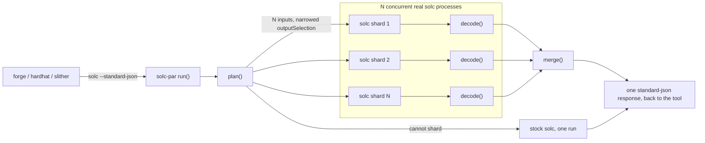
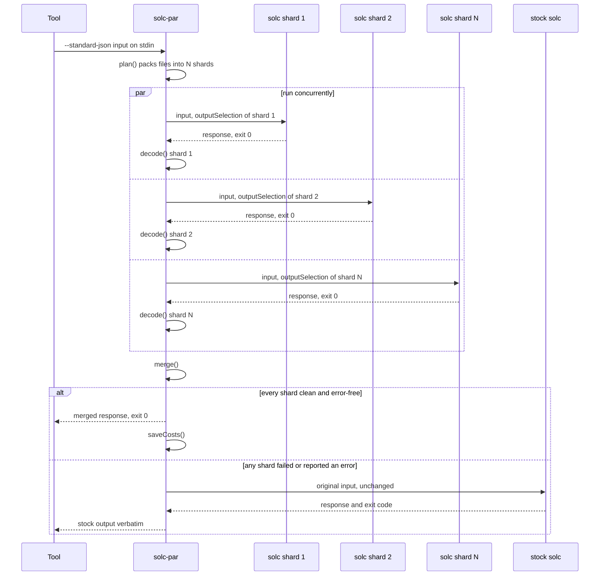
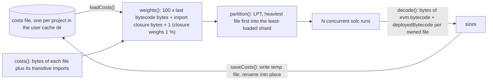
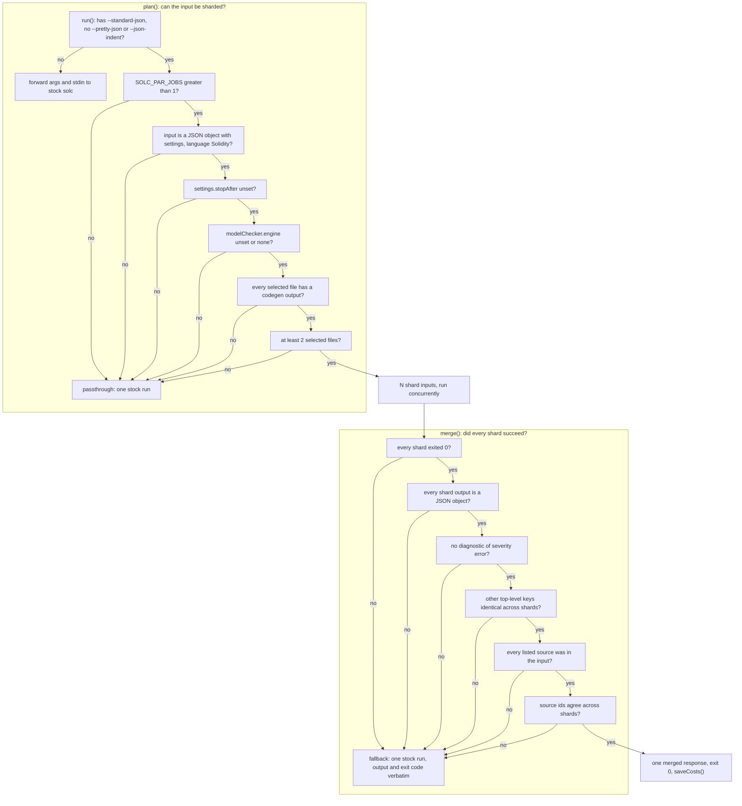

# Architecture

solc-par is a single Go binary (`main.go`, standard library only) that sits where a
tool expects `solc`. Every diagram below names the function in `main.go` that owns the
box, so the picture and the code can be checked against each other. [DESIGN.md](DESIGN.md)
has the measurements behind each decision; this file only shows the shape.

## 1. One compile, end to end

A tool runs `solc-par --standard-json` exactly as it would run `solc`. `run()` reads the
whole input, `plan()` either hands it to stock solc unchanged or cuts it into N shard
inputs that differ only in `settings.outputSelection`, and the shards run as N concurrent
real-solc processes. Each shard's response is decoded the moment that process exits, while
the others still run; `merge()` then copies the owned bodies verbatim into one response.

Anything that is not a `--standard-json` compile (`--version`, the legacy CLI) never
reaches `plan()`: `run()` forwards the arguments and stdin to the real solc as-is.

## 2. Shards in flight, and the fallback

The shards are independent processes with no shared state, so they run fully concurrently
(`sync.WaitGroup`, one goroutine per shard). The merge accepts only a clean, error-free
response from every shard. Anything else - a non-zero exit, a non-JSON body, a diagnostic of
severity `error`, a source that was not in the input, a top-level key solc-par does not
merge that differs between shards - makes `run()` discard all shard
output and compile the untouched input once more with stock solc, returning that output and
exit code verbatim.

The price of the fallback is one extra stock run on the error path; the benefit is that an
error response is byte-for-byte solc's, including its shape and diagnostics.

## 3. The learned-costs loop

Per-file compile cost spans two orders of magnitude, so balanced shards need a cost
estimate. The size of the code solc generated for a file last time tracks its compile cost
closely (Pearson 0.92-0.99), so every successful build records it and the next build packs
with it. The first build of a project has only the import closure of each file, a much
weaker proxy, which is why the second build is faster than the first. A file never seen
before gets its closure scaled to the ratio of learned size to closure over the known files.

`SOLC_PAR_COSTS` names the file (`""` disables it); otherwise it lives under the user cache
dir, keyed by a hash of `--base-path` or the working directory. A missing or damaged file
only costs balance, never output.

## 4. Passthrough and fallback decisions

Two gates, in code order. The first box is the argument check in `run()`; after it, `plan()`
returns `nil` (passthrough: one stock run) when the input cannot be sharded safely; `merge()` returns an error (fallback: one stock run) when the
shards did not all succeed. Both paths end in the same `solcRun(solc, args, in)` on the
original bytes.

"Codegen output" is the set solc itself uses to decide whether to generate code: `*`,
`evm.*` except `evm.methodIdentifiers`, `ir*`, `yulCFGJson`, `ethdebug` (`isCodegen()`).
The `merge()` checks run per shard in shard order; the first failure wins and
`SOLC_PAR_DEBUG=1` prints it.

## 5. What LPT packing buys

Illustrative, from the numbers in DESIGN.md: aave-v3-origin takes 333 s in one stock process;
with learned costs and 12 shards the shards finish within +/-1 % of each other at about 53 s,
so no core waits for a straggler. The gap between 53 s and the ideal 333 / 12 = 28 s is work
every shard repeats (parse and analysis of all sources, re-optimising contracts deployed with
`new`) and the lower clock of a fully loaded machine, not packing.

```mermaid
gantt
    title aave-v3-origin, via-IR, 12 jobs (seconds, illustrative)
    dateFormat X
    axisFormat %s
    section stock solc
    one process        :s0, 0, 333
    section solc-par warm
    shard 1            :p1, 0, 53
    shard 2            :p2, 0, 53
    shard 3            :p3, 0, 53
    shard 4            :p4, 0, 53
    shard 5            :p5, 0, 52
    shard 6            :p6, 0, 53
    shard 7            :p7, 0, 53
    shard 8            :p8, 0, 52
    shard 9            :p9, 0, 53
    shard 10           :p10, 0, 53
    shard 11           :p11, 0, 52
    shard 12           :p12, 0, 53
```

## Where each box lives

| Box                      | `main.go`                                   |
|--------------------------|---------------------------------------------|
| forward / passthrough    | `run()` (argument check), `plan()` returning `nil`, `solcRun()`, `emit()` |
| N shard inputs           | `plan()`, `object()`, `marshal()`           |
| cost estimate            | `costs()`, `resolve()`, `weights()`         |
| LPT packing              | `partition()`                               |
| concurrent shards        | `run()` (`sync.WaitGroup`), `solcRun()`     |
| decode as they finish    | `decode()`, `size`                          |
| merge                    | `merge()`, `object()`                       |
| fallback                 | `run()` after `merge()` returns an error    |
| costs file               | `costsPath()`, `loadCosts()`, `saveCosts()` |
