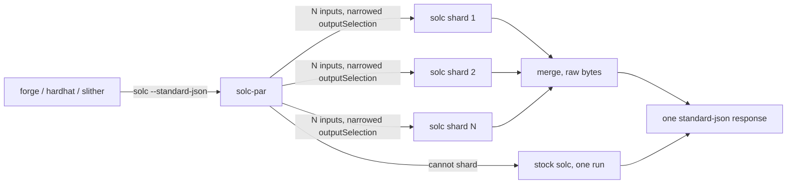

# solc-par

A drop-in `solc` wrapper that compiles a Foundry (or any standard-json) project on all
your CPU cores, with **byte-identical bytecode, ABI and metadata**.

`solc` is single-threaded: a big via-IR project spends minutes in one core while the
others idle. solc-par shards the standard-json compile by source file, runs the shards
as concurrent real-`solc` processes, and merges the outputs back into one response.
Nothing in solc is patched — it is the stock binary you already use.

```
aave-v3-origin, solc 0.8.37, via-IR, Apple M4 Pro (12 cores)
  forge build --use solc            333 s
  forge build --use solc-par         64 s  (cold)  /  ~53 s (warm)
```



- [INTEGRATIONS.md](INTEGRATIONS.md) — validated setups for Foundry, Hardhat 2/3, Slither
  and crytic-compile, Echidna/Medusa, Ape, solc-select and plain CLI, with copy-ready
  configs under [`examples/`](examples/).
- [BENCHMARKS.md](BENCHMARKS.md) — all measurements, the solc version compatibility
  matrix, and how to reproduce them.
- [ARCHITECTURE.md](ARCHITECTURE.md) — diagrams of the pipeline, the fallback and the
  learned-costs loop; [DESIGN.md](DESIGN.md) — why each decision, with the numbers.

## Install

```sh
go install github.com/bussyjd/solc-par@latest     # or: git clone … && go build
```

A single static binary, standard library only (Go ≥ 1.26 to build).

## Use with Foundry

```sh
export SOLC_PAR_SOLC="$HOME/.svm/0.8.37/solc-0.8.37"   # the real solc to run
forge build --use "$(which solc-par)"
```

Foundry calls solc-par exactly like solc. Anything that is not a `--standard-json`
compile (`--version`, …) is forwarded unchanged.

On a dev loop the usual `forge build` incremental cache still applies: solc-par only
speeds up the compiles forge actually runs.

### Environment

| Variable         | Meaning                                                                                  | Default                                  |
|------------------|------------------------------------------------------------------------------------------|------------------------------------------|
| `SOLC_PAR_SOLC`  | Path of the real `solc` binary. **Required.**                                            | —                                        |
| `SOLC_PAR_JOBS`  | Number of shards / concurrent solc processes. `<= 1` disables sharding.                  | CPUs available to the process (affinity mask and, on Linux, cgroup CPU quota and 1 shard per GiB of cgroup memory limit) |
| `SOLC_PAR_COSTS` | File that remembers each source's generated-code size to balance the next run. `""` disables. | one file per project under the user cache dir (`~/Library/Caches/solc-par`, `~/.cache/solc-par`, `%LocalAppData%\solc-par`) |
| `SOLC_PAR_DEBUG` | Any non-empty value: say on stderr why a compile fell back to stock solc.               | unset                                    |
| `SOLC_PAR_CHILD` | Reserved: set by solc-par for the solc it runs; solc-par refuses to start when it is set. | unset                                    |

The first build of a project packs shards by import size (a weak proxy); every later
build packs by the bytecode size solc generated last time, which tracks compile cost
closely. Expect the second build to be somewhat faster than the first.

Memory: every shard is a full solc process that parses and analyses all sources, so a
build takes roughly `SOLC_PAR_JOBS` × (one shard's memory), about 3× a stock run in
total: on openzeppelin-contracts (via-IR) 12 shards peak at 3.7 GB against 1.2 GB for
stock. solc-par itself holds the shard responses while merging (tens of MB there, a few
hundred MB on the largest project measured). Lower `SOLC_PAR_JOBS` on a memory-constrained
machine.

Stopping: SIGINT or SIGTERM to solc-par kills every solc it started and exits with the
shell's status for that signal (130, 143); nothing is written to stdout.

## Guarantees

- **Identical artifacts.** For every contract: `abi`, `evm.bytecode`, `evm.deployedBytecode`,
  `metadata` and every other requested output are byte-for-byte what a single stock solc
  run produces, and the response ends with a newline like solc's. Checked on every
  release across four large projects (Aave v3, OpenZeppelin, Uniswap v4 core, GMX
  synthetics), see `bench/compare-artifacts.py`.
- **Same errors, same exit code.** If any shard reports a compilation error, exits
  non-zero, returns anything unexpected, lists a source that was not in the input, or
  disagrees with the other shards on a top-level key solc-par does not merge, solc-par
  compiles the input once more with stock solc and returns *that* output and exit code
  verbatim. Error responses are therefore exactly solc's; the price is one extra
  (analysis-only, for type errors) run on the error path. `SOLC_PAR_DEBUG` prints why a
  fallback happened.
- **Safe passthrough.** Inputs solc-par cannot shard go to stock solc untouched:
  `language` other than `Solidity` (Yul, AST import), `stopAfter`, `modelChecker` runs,
  `--pretty-json`/`--json-indent`, `--standard-json <file>` / `--input-file <file>` (only
  input on stdin is sharded), input that is not a JSON object with a `settings` object,
  fewer than two files with code-generation outputs, a selected file without a
  code-generation output, `SOLC_PAR_JOBS` of 1 or less.
- **solc versions.** Supported and checked in CI from solc 0.5.0 to the latest release
  (`bench/compat.sh`, see [BENCHMARKS.md](BENCHMARKS.md#solc-version-compatibility));
  older binaries are correct through the fallback but may not be accelerated.

## Known differences (warnings only, successful compiles)

- Warning **order** can differ from a stock run.
- solc keeps only its first 255 warnings and then prints "There are more than 256
  warnings". Each shard applies that cap to its own list, so a project past the cap gets
  *more* warnings from solc-par than from stock (every warning stock shows is included).

Errors, bytecode and ABI are never affected. The code was reviewed for soundness before
release; the findings and what changed are in [REVIEW.md](REVIEW.md).

## How it works, in one paragraph

Each shard receives the original input verbatim except `settings.outputSelection`, which
is narrowed to the files it owns. solc still parses and type-checks everything (that is
cheap) but only generates and optimises code for the selected files — and for contracts
they deploy with `new`, which is why the result is identical to a full run. Shards are
packed longest-first using the per-file bytecode sizes learned from the previous build.
Outputs are decoded as each shard exits and merged as raw bytes, so the merge of a
100 MB response costs about 0.1 s. The remaining gap to a perfect speed-up is solc work
that every shard repeats (parsing, analysis of imports, optimising `new`-deployed
dependencies) plus the clock-frequency drop of a fully loaded machine; both are
quantified in [DESIGN.md](DESIGN.md).

## Status

Used daily on the projects above. The sharding model is simple by design; if you find an
input where the output is not identical to stock, that is a bug — please open an issue
with the standard-json input.

## License

MIT, see [LICENSE](LICENSE).
